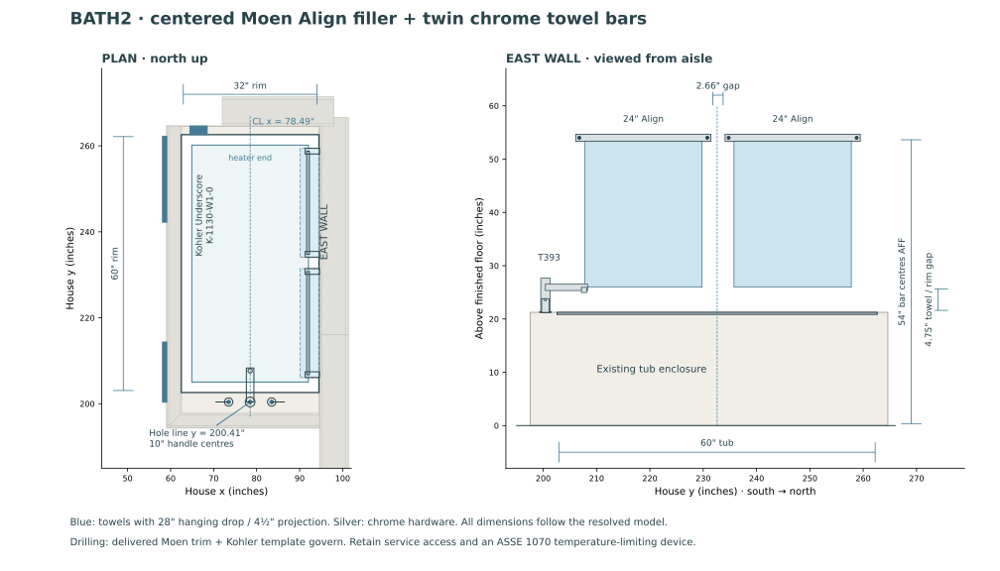

# Bath2 tub hardware — 2026-10-22

The Kohler Underscore K-5713-W1-0 stays in its existing enclosure. Moen Align T393 chrome
trim replaces the Delta Trinsic filler, using Moen 4794 rough-in. The filler mounts on the
constructed deck, independently of the tub brand. Two Align YB0424CH bars sit side by side
above the tub. Bath2's plumbing fittings and bathroom accessories are chrome; genuine
stainless cabinet pulls remain stainless. Other rooms retain their existing selections.

## Location and fit

Coordinates below are house-plan inches; elevations explicitly distinguish the storey
framing datum from finished floor, which is 1½ in. above that datum.

| Item | Location / dimension |
|---|---|
| Tub and filler centerline | x = 76.615 in.; filler moved 4.615 in. east |
| Tub center | y = 232.77 in. |
| Filler hole line | y = 200.41 in., unchanged |
| Filler envelope center | x = 76.615, y = 203.800625 in.; faces north |
| Filler mounting plane | 22¾ in. above framing datum = 21¼ in. AFF |
| Handle holes | x = 71.615 and 81.615 in.; 10 in. centers |
| Outlet center | x = 76.615, y = 207.66 in.; 2.67125 in. inside published basin-top edge |
| Trim envelope | 15 15/16 × 9 1/32 × 6 13/32 in. |
| Bar centers | y = 218.77 and 246.77 in.; both 54 in. AFF |
| Bar hardware | 25.34 in. overall, 24 in. mounting centers; 2.66 in. between bars |
| Loaded towel allowance | 28 in. drop, 4½ in. wall projection; bottom at 26 in. AFF |
| Towel bottom above tub rim | 4¾ in. |

The manufacturer's drawing distinguishes **7 29/32 in. overall spout reach** from
**7¼ in. to the outlet center**. The spout's overall height is 6 13/32 in.; its outlet
underside is 3 23/32 in. above the deck. These replace the old representative Delta arch.
Uncalled-out tube diameters remain visualization approximations.

The closed levers point outward and their full quarter-turn sweeps clear the center spout.
The escutcheons and 1¼ in. rough holes fit on the foot ledge, south of the shell's outer
rim. The nearest rough hole is more than 6 in. from the Bask receptacle body. The holes
retain the original ledge station rather than moving with the center of the new envelope.
The 4794 accepts the modeled 2¼ in. rough deck plus ½ in. finish, and includes cold-expansion
PEX adapters for the house's PEX-A supply. Its 13 gpm at 45 psi is a valve rating, not an
installed-flow prediction.

## Supports and service handoff

Four towel-bar posts use three SPF 2×6 backing blocks, all flush with the bathroom stud
face and centered at 55½ in. above the framing datum. The middle block supports the two
inner posts. Actual clear bays are y = 244.75–259.25 and 228.75–243.25 on W-M-BA2E,
and 192.75–207.25 on W-M-BA2E2. The southern post crosses the authored wall split at
y = 216 in.; both wall segments are the same continuous physical plane.

The fixing check follows that connected, coplanar continuation and reports its actual wall.
It does not borrow wood across a gap, an offset face, or the opposite staggered stud row.
Loaded-towel, backing/stud, and backing/service intersections are checked in regression tests.

Order **T393 and 4794 together**, and include an ASSE-conforming temperature-limiting device.
Moen's sheet identifies separately purchased 104465 as ASSE 1070 certified. The filler price
includes a $100–200 material allowance for this device and its fittings; that is an allowance,
not a vendor quote or an additional routed valve element.

Keep the existing 14×14 in. west-apron panel removable. The foot bay remains free of new
structural obstructions; the valve holes lie in its open plan area. Before closing the
apron, demonstrate access to each under-deck valve nut and hose release, drain connection,
Bask plug and power supply with the actual parts installed. Hose loops and the limiting
device must remain serviceable and clear of electrical components. Final access adequacy
and template clearances require the delivered parts; the model does not represent the
rough's complete hose/manifold geometry.

**Correction to the earlier selection note:** Kohler guide 1196030-2-E requires service
access but does not specify the previously quoted 20×15 in. minimum. Retain the actual
panel size in the drawing and verify usable access rather than claiming that minimum.
The tub's template 1268438-7 and delivered Moen trim govern final drilling.

## Orderable finishes and costs

Bath2-only chrome variants: YB0486CH hand-towel bar, YB0403CH shower-side hook, YB0408CH paper
holder, Delta Arvo 15840LF lavatory faucet, and Kohler K-7272-CP drain/overflow. The shower
retains its previously selected chrome head and Delta thermostatic trim.

Chrome describes a finish. Moen specifies zinc for the bath towel bars and hook, and zinc
posts with a stainless steel bar for the hand-towel holder. These are not solid-stainless
assemblies. Product identity lives in the catalogs; material and installation allowances
live in `prices.toml`. The tub drain remains included in the tub allowance; the Arvo remains
in the plumbing faucet allowance, so neither is billed twice.

Moen's live shop data on 2026-10-22 listed T393 at $534.84 and 4794 at $169.44; the rendered
T393 page showed $501.40. The filler material band covers both plus the limiting-device
allowance. Chrome hardware unit prices were $75.20/bar, $51.20/hand bar, $34.44/hook,
and $62.76/paper holder, before shipping and tax. Reconfirm at ordering.

## Sources and regeneration

- [Moen T393 dimensional drawing](https://assets.moen.com/shared/docs/product-specifications/t393sp.pdf)
- [Moen 4794 rough-in specification](https://assets.moen.com/shared/docs/product-specifications/4794sp.pdf)
- [Moen towel bar specification](https://assets.moen.com/shared/docs/product-specifications/yb0424sp.pdf)
- [Moen hand-towel bar specification](https://assets.moen.com/shared/docs/product-specifications/yb0486sp.pdf)
- [Kohler heated-bath installation guide](https://techcomm.kohler.com/techcomm/pdf/1196030-2.pdf)
- [Chrome Arvo faucet](https://www.deltafaucet.com/bathroom/product/15840LF.html)
- [Chrome Clearflo drain](https://www.kohler.com/en/products/bathtubs/shop-bathtubs-shower-drains/clearflo-slotted-overflow-bath-drain-7272?skuId=7272-CP)

Regenerate SVG and PNG from the repository root:
`.venv/bin/python scripts/render_bath2_tub_hardware.py`.
