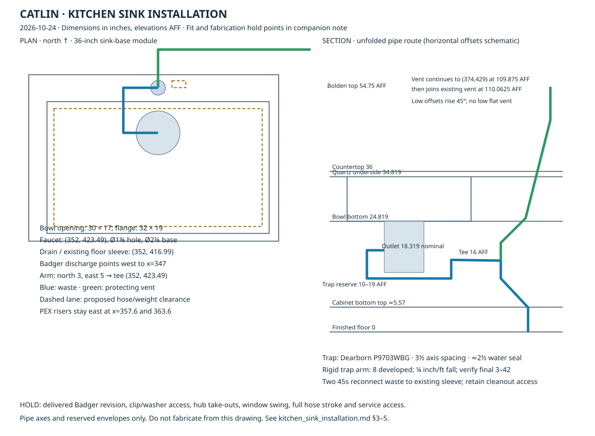

# Kitchen sink, Bolden faucet and Dearborn trap

Selected 2026-10-24. This is the installation specification for FX-M-KITCH-SINK,
APPL-M-DISP and FURN-M-KIT-SINKBASE. Plan coordinates are inches; elevations below
are above finished floor (AFF). Main-storey pipe elevations add **0.9375 inch**,
the resolved concrete-cap walking plane. Do not substitute the wood-bay floor datum.

**Status: products and connection layout specified; fabrication release requires
the physical checks in §5.** Catalog minimum cabinet dimensions do not certify the
clips, faucet mounting washer, window sash or hose travel.

## 1. Order and connections

| Item | Order | Connection / included pieces |
|---|---|---|
| Bowl | Kraus KHU100-32, 16 gauge | 32 × 19 outside, 30 × 17 bowl, 10 deep; 3½-inch drain |
| Faucet | Kraus Bolden KPF-1610SFS, spot-free stainless | Single 1⅜-inch quartz hole; no escutcheon; right-hand lever moves forward |
| Disposer | Existing InSinkErator Badger 5 | Use its sink flange, gasket, mounting assembly and supplied 1½-inch discharge elbow |
| Trap | Dearborn P9703WBG | White polypropylene 1½-inch tubular P-trap, reversible J-bend, PVC trap adapter, nuts and washers |
| Rigid connection | 1½-inch PVC trap arm into side inlet of upright 2 × 2 × 1½-inch sanitary tee | 2-inch waste below; 2 × 1½ reducer above for vent; smooth DWV fittings |
| Faucet supplies | Separate fixture stops with ⅜-inch compression outlets | Reduce the existing 1¼-inch cold and ¾-inch hot PEX branch/manifold connections; retain dishwasher hot branch |

PEX carries potable supply water and never connects to the trap. The faucet's factory
26½-inch supply lines connect to the compression stops; do not stretch them across the
cabinet. Locate the stop outlets to retain slack and access. Existing large branch ball
valves are isolation valves, not substitutes for the faucet's compression connection.
The sink's included BST-1 strainer is **unused**, not stacked above the disposer flange.
Connect the dishwasher to the Badger inlet after removing its knockout; fasten the
discharge hose as high as possible beneath the counter per Minnesota 4714.0807.

## 2. Countertop and faucet set-out

Derive the faucet centre from the resolved bowl opening: x at the opening midpoint,
y at its rear edge + 1-inch rear flange + 2-inch offset. Current set-out:

| Feature | Coordinate / elevation |
|---|---|
| Cabinet module | x=333.375–369.375; y=401.375–425.375 |
| Bowl opening | x=337–367; y=403.49–420.49 |
| Steel flange | x=336–368; y=402.49–421.49 |
| Faucet hole centre | **(352, 423.49)**; diameter **1.375** |
| Drain / sleeve / cleanout | **(352, 416.99)** |
| Quartz | top 36; underside 34.819; thickness 1.181 |
| Bowl bottom | 24.819 |
| Faucet top / parked outlet | 54.75 nominal / 42.25 |
| Parked outlet plan point | (352, 414.865), inside the bowl |

The 2⅛-inch faucet base leaves 0.9375 inch between its front edge and the steel
flange. The drilled hole leaves 2.3125 inches of stone to the rear bowl opening.
These are layout dimensions, not a quartz fabricator's minimum-web approval.
Use the delivered sink template for radii/reveal and the delivered faucet's gasket,
metal mounting washer and nut below the quartz. The current manual accepts decks up
to 3⅜ inches; do not put a rail or sink-support member beneath the mounting nut.

Keep the existing ⅝-inch east flange-to-cabinet-side clearance; support/clip access
must be checked before cutting. No cabinet side or suspension-rail cutting is specified.
Use two door fronts, with no drawer or shelf through the plumbing compartment.

## 3. Under-sink plan and section

The drawing shows pipe axes and **reserved** equipment envelopes, not fabrication
cut lengths. Fit hub insertion and elbow take-outs from the delivered fittings.

| Connection | Plan x,y | AFF |
|---|---|---:|
| Disposer axis / sink bottom | 352,416.99 | 24.819 |
| Disposer outlet, pointed west | 347,416.99 | 18.319 nominal |
| Tubular trap inlet | 347,416.99 | Trim supplied elbow after dry-fit |
| Trap outlet / start of rigid arm | 347,420.49 | 16.1667 |
| Rigid arm corner | 347,423.49 | 16.1042 |
| Upper-terminal cleanout cap (front/west access) | 345.5,419 | 16.1042 |
| Sanitary tee / protecting vent origin | 352,423.49 | 16 |
| Waste, start of 45-degree return | 352,423.49 | 12 |
| Waste, end of 45-degree return | 352,416.99 | 5.5 |
| Existing sleeve / accessible cleanout | 352,416.99 | 0 |
| Vent, start of first 45-degree offset | 352,423.49 | 20 |
| Vent, inside north wall | 352,429 | 25.51 |
| Vent, east of window framing | 374,429 | 47.51 |
| Vent, top of local riser | 374,429 | 109.875 |
| Join existing PR-M-KITCH-VENT | 392,429 | 110.0625 |

Provide the upper-terminal cleanout CO-M-KITCH-ARM at the arm corner, with its
cap accessible toward the front/west and 18 × 18 inches clear for service. Check the access path
past the trap during dry-fit; removing the trap does not replace the specified cap.

Point the Badger elbow **west** to keep the trap away from the PEX risers at
(357.6,421.5) and (363.6,421.5). Dearborn's drawing gives 3½ inches between inlet
and outlet axes, a 4⅝-inch inlet-top to outside-bottom dimension and approximately
2½ inches of water seal. Reserve **10–19 AFF** for the complete trap assembly;
confirm its actual bottom after trimming the disposer elbow. The cabinet floor's
top is approximately **5.57 AFF** (30-inch frame beneath the quartz, ¾-inch bottom).
Keep the cleanout accessible through a sealed service opening in that bottom.
The diagonal waste return also needs a fitted bottom-panel opening; no side cutting.

The 8-inch rigid arm falls ⅙ inch at ¼ inch/foot before reaching the vented tee.
Its centreline length is well inside the 42-inch limit for a 1½-inch trap arm and
exceeds the three-inch minimum. Verify final developed length **from the actual trap
weir to the inner vent edge**, including fitting geometry, within 3–42 inches; do
not measure from the sink drain or count the downstream floor drop as trap arm.

The protecting vent is connected at the upright sanitary tee **before** the waste
drops. Both low offsets rise at 45 degrees, meeting the UPC definition of vertical;
there is no horizontal dry vent below flood-rim + 6 inches (42 AFF). It first moves
5.51 inches north/up into W-M-N1, then 22 inches east/up below the window sill,
then rises at x=374, clear of the window's jack/king framing. The final horizontal
18 inches rises 3/16 inch to the existing vent, above the rim. Keep bored-hole
edges within permitted stud limits; check the actual fitting envelope at the
window sill and the rail screw zone before drilling. No header bore is specified.
The 2-inch waste returns on two 45s to the unchanged sleeve and basement drain.

## 4. Hose, controls and service space

Reserve the clear hose/weight travel lane **x=354–356, y=423.5–424.5, z=8–34 AFF**.
This is a proposed outer clearance envelope, not a published weight dimension.
Guide the loose hose gently east of the vent, with no sharp bend or restraint on
the moving section. The manufacturer specifies 16 inches of hose reach; prove the
full pull-out and free return with the actual weight, quick connector and hoses.
Widen/reposition the lane within the cabinet if required by the delivered kit;
do not claim a fit from the one-inch-deep reservation alone.

Keep sink support, mounting washer, rail, supply insulation, dishwasher drain hose,
electrical enclosure and stored items out of that travel. Maintain front access
to slip joints, disposer mounting ring, reset button and service wrench socket.
Do not mount the control enclosure in the trap-removal path. Set the disposer
pushbutton on the delivered countertop template outside the faucet base/handle
sweep and sink clips; do not drill an uncoordinated second hole.

**Window restriction:** WIN-M-KITCH is an inward-opening Drutex tilt-turn, with a
rough sill at 41.0625 AFF. The faucet reaches 54.75 AFF directly in front of it.
Full inward turn is therefore not certified and is likely obstructed. Check the
dealer's actual sash/handle section and tilt sweep with a faucet mock-up. Retain
the specified window and faucet for now; do not promise full turn operation or
change window hardware silently. This is a fabrication hold point, not a passed
clearance check.

## 5. Release and purchasing

Before quartz drilling, assemble the actual sink, support/clip kit, faucet washer,
Badger flange and discharge, trap and rigid fittings in the assembled SEKTION box.
Verify the ⅝-inch east clip access, all hub take-outs at the 16-inch tee, bottom
penetrations, protected vent route, window operation, full hose stroke and service
access. Leak-test filled bowl, disposer, dishwasher discharge and supply joints.

The currently published Badger US sheet is internally inconsistent: its drawing
labels **12⅝ inches overall**, while its table says **11½ inches**. It gives an
outlet six inches below the sink bottom **plus ½ inch for stainless steel sinks**.
The model retains its existing 11½-inch body (bottom 13.319 AFF); use the delivered
unit's mounting stack and dimensions before setting the trap. A 12⅝-inch body
would nominally reach 12.194 AFF before any further mounting-stack correction.
Do not purchase an extension flange or cut an elbow on the assumption that these
revisions share the same mount height.

The faucet bills once on the kitchen cold-stop installation; trap and connector
kit bill once on APPL-M-DISP. The sink row covers bowl/support and set/connect
labour only; the separate general faucet allowance excludes the kitchen. Factory
trap adapter, washers, faucet hoses and Badger elbow are included, not extra orders.
Rigid pipe and elbows bill in the existing pipe/fittings takeoffs; the loose
kit carries the actual reducing sanitary tee, vent reducer and joint consumables.
The generic graph labels that upright tie-in as a wye; its single wye-2x1.5in price
row is zero because the named kit buys the correct tee. The upper-arm cleanout
fitting, extension and cap have their own material kit; the cleanout schedule is
a quantity view, not a second purchase. Connector/fixture-stop costs
remain labeled planning allowances; faucet and trap prices have dated retail links
in prices.toml.

For trade handoff, the plumber supplies the trap, connector and cleanout kits;
the electrician supplies the seven 24V control parts. They share the disposer
installation carrier in the takeoff, whose generic appliance-kit trade grouping
is electrical; use this split when preparing the plumbing and electrical bids.

## Sources

- [Kraus KHU100-32 sheet](https://www.kraususa.com/media/catalog/product/documentation/KHU100-32-Spec-Sheet.pdf).
- [Bolden June 2024 manual](https://www.kraususa.com/media/catalog/product/documentation/KPF-1610-IM.pdf) and [specification](https://www.kraususa.com/media/catalog/product/documentation/KPF-1610-Spec-Sheet.pdf).
- [Dearborn LCS1353 dimensional submittal](https://assets.unilogcorp.com/267/ITEM/DOC/Dearborn_P9703WBG_Specification_Sheet.pdf).
- [Badger US submittal H1013-24A-83-10](https://www.insinkerator.com/documents/badger-5-specifications-en-us-121004.pdf).
- [Minnesota 4714.1002: trap protection](https://www.revisor.mn.gov/rules/4714.1002/), [4714.0905: vent rise](https://www.revisor.mn.gov/rules/4714.0905/), and [4714.0807: dishwasher discharge](https://www.revisor.mn.gov/rules/4714.0807/).
- [IAPMO vertical-pipe definition](https://iapmo.org/media/bwbjc5to/2019-cpc-supplement-effective-07-01-2021.pdf): within 45 degrees of vertical; adopted UPC definition applies to the sloping rises.
