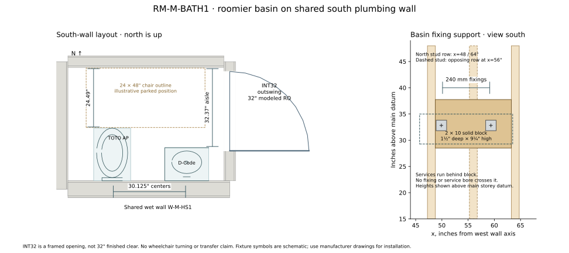

# RM-M-BATH1 — wall basin and timber support

Current selection, 2026-10-21. Replaces the Vero 0703500008 hand-rinse basin.
The owner chose a roomier bowl, then returned it to the shared south plumbing wall
and requested an INT32 outswing farther north. The north-wall layout is superseded.

## Fixture and fittings

| Item | Specification |
|---|---|
| Basin | **Duravit D-Code 07054500002**, white ceramic, wall mounted, glazed underside, overflow, one factory-punched central faucet hole; cUPC listed |
| Overall | Published US footprint **17¾″ wide × 13⅜″ projection**; metric drawing 450 × 340 mm, china height 145 mm (US nominal 5¾″). Allow ceramic tolerances when setting out. |
| Usable bowl | Manufacturer's internal dimensions **15⅜″ × 8½″**. These are plan dimensions, not vertical water depth. The replaced Vero's bowl was 10⅝″ × 7⅛″. |
| Mounting height | **34″ rim above finished floor**. China underside 718.6 mm / 28.2913″ AFF; the model's additional 140 mm is the generic faucet symbol, not additional china. |
| Faucet | **Duravit B.2 S B21010001U10**, chrome, single lever, single hole, no cover plate; 4″ reach, 3⅝″ outlet height above deck, adjustable aerator, 3/8″ compression hoses, US pop-up/drain assembly; WaterSense and cUPC listed. This compact mixer replaces the Arvo selection in this room. |
| Waste | Included overflow-compatible pop-up; 1¼″ chrome-plated brass tubular P-trap with accessible cleanout/slip joints, code-compatible transition to the existing 1½″ wall arm. Exposed trap arm offsets 1⅛″ west to the wall stub at x=53½″; do not use a corrugated flexible waste. |
| Supplies | Accessible quarter-turn stops below the basin, hot at x=50½″ and cold at x=60″; braided connectors sized to reach without tension. Both come from the south wet wall. Protect exposed hot supply and waste with smooth removable covers; retain access to stops. |

The bowl is wider and deeper in plan than the previous hand-rinse selection. Confirm
hand clearance and splash behavior with the actual basin and mixer before final drilling;
set the aerator into the bowl and check handle/pop-up operation against the finished wall.
This is a compact powder-room basin, with no claim of accessible knee clearance or a
load-rated transfer support.

## Blocking and fixing detail

The basin backs onto the north face of **`W-M-HS1`**, the existing 5½″-cavity
staggered plumbing wall shared with RM-M-BATH2. No wall faces move. `W-M-STOS`
returns to the normal 16″-module partition; its former special 8″ stud layout and
basin fixing blocks are removed.

Provide one **solid nominal 2×10 SPF block**, actual **1½″ thick × 9¼″ high**,
flush with the north stud faces, between the north-row studs at **x=48″ and 64″**.
This shallower support preserves a service lane behind it and clears the opposing
staggered stud at x=56″. Do not substitute a full-depth block across both stud rows.

| Model element | Horizontal extent from west wall axis | Bottom / top above main storey datum |
|---|---|---|
| `BK-M-HS1-BASIN` | x=48¾″ to 63¼″; cut length 14½″ | 28½″ / 37¾″ |

The block occupies **y=269¼″ to 270¾″**. Fasten each end with **three 16d common
nails, 0.162″ × 3½″**, face-nailed through the adjacent stud before closing the wall;
stagger the nails vertically. Connect the supporting full-height studs to the sole
and top plates per the partition framing schedule. Photograph the block, connections
and services before wall closure.

The basin center is **x=54⅝″**. Manufacturer drawing `1266560` gives fixing holes
**240 mm apart and 55 mm below the rim**. Set mounting axes approximately at:

- **x=49.901″ and 59.349″**, both within solid timber.
- **31.835″ AFF**, or **32.821″ above main storey datum** with the current 0.9862″
  finished-floor build-up. Recalculate from actual finished floor if that changes.

Use two **M10 through-bolts**, zinc plated, with **2″ square × ⅛″ steel rear
backing plates**, ceramic-compatible nylon shoulder bushes, front washers and nuts.
Select bolt length from actual china and wall build-up (nominal M10 × 120 mm), with
full nut engagement. Rear plates bear directly on timber; no gypsum anchors. Keep
both plates fully on the block, including the left plate near the stud. Confirm the
through-bolt arrangement and ceramic bushes against Duravit's supplied installation
requirements before drilling; tighten evenly by hand without bare steel on ceramic.
This support is for the basin; it is not specified as a grab bar or transfer support.

The waste/vent tee is at **x=53½″, y=268″, 20″ above main datum**, behind the
block. The 1½″ vent rises to 45″ before offsetting east to x=58″ and rising to the
upper service band, clear of the study ERV branch. It joins the existing WC vent;
there is **no service bore through the basin block**. Hot is at x=50½″, y=267½″;
cold comes from the existing x=60″ wet-wall riser. Supply outlets are 24″ above main
datum, below the block. Check these routes before installing the rear plates.

The 1½″ waste drops through the wet wall to the basement service space, then runs
3″ north and 18½″ east to the head of the existing 4″ collector. Its horizontal
legs are below the I-joist bottom flange. The hot branch also crosses below that
flange and stays north of the WC branch. These are modeled routes, not a connection
to the upstairs stack on the opposite wall.

## Door, privacy and movement

The TOTO AP bowl remains **21¼″ projection** and centers at **x=24½″**. Its carrier
and access panel align with it; the waste drops straight down, without the former
short lateral offset inside the carrier. The study data conduit’s north–south leg moves 4″ west in the basement ceiling
to clear this drop, retaining its existing bend count.

The basin and toilet now share the south wall. This restores some visual screening
from the hall, although an open wall basin provides less screening than a cabinet.
The north partition is clear of the basin, mirror and basin receptacle.

- Finished basin-front aisle: **32.365″** (about 32⅜″).
- Toilet front to north finish: **24.49″**.
- Fixture centers: **30⅛″** apart; basin center to east finish: **15″**.
- `D-M-BATH1` is now **`DT-INT-SWING32`**, still an outswing, southern hinge.
  Modeled opening: **y=283½″ to 315½″**. Its north end moves 11½″ north and its
  south end 9½″ north relative to the prior 30″ opening; center moves 10½″ north.
- North opening edge to north finish: **1⅝″**; rip the bathroom-side north casing
  to approximately 2⁷⁄₁₆″ rather than the usual 3½″, and verify the supplier jamb
  at the corner. Geometric doorway/aisle overlap is **30.740″** before jambs and leaf.
  The basin front is south of the open leaf's usable passage; it is no longer the
  controlling restriction once those door components are included.

**INT32 is a 32″ framed model opening, not a guaranteed 32″ clear passage.** With
this model's 1″ jamb allowance each side, 45 mm leaf and applied stop, allow roughly
**28″ clear at 90°**, subject to the actual door supplier and hinge. This is an
improvement over INT30, but still a narrow-chair contingency layout. It does not
establish a wheelchair turn, seated transfer space or verified basin knee clearance.
The dashed 24×48″ narrow chair in the drawing is an illustrative parked footprint, not a
swept-path assessment. A true 32″ clear door would require a larger opening and a
further layout review. [Clear-width measurement guidance](https://www.access-board.gov/ada/guides/chapter-4-entrances-doors-and-gates/).

The existing **1½″ northward STOS/STOS2 shift stays**; no additional wall move is
needed for this arrangement. The mirror light, its backing and basin GFCI move to
HS1 with the basin; the entry switch moves south of the new doorway.

## Toilet-paper holder provision

No factory holder attachment is specified for this D-Code basin. **Do not drill the
china or assume its mounting bolts accept an accessory bracket.** A holder beside
its west edge is feasible using a separate wall-fixed projecting bracket or a
manufacturer-approved accessory. Keep the roll and bracket outside the WC's 15″
side zone (east boundary x=39½″), below the basin rim, and out of the north entry
lane. Trial its seated reach and roll-changing access before setting its independent
blocking. Holder selection and that bracket detail remain open; neither is claimed
as included with the basin or as a grab support.

## Manufacturer references

- [Duravit US D-Code 070545](https://pro.duravit.us/pro/html/default/402880943a1b6e1b013a1bd282eb0051.us-en.html?ncat=washbasins&nser=7120&product=94764)
- [Manufacturer plan drawing 1266559](https://csassets.duravit.com/1/2/Duravit_TD_1266559.pdf)
- [Manufacturer fixing/elevation drawing 1266560](https://csassets.duravit.com/1/2/Duravit_TD_1266560.pdf)
- [Duravit US B.2 S mixer B21010001U10](https://pro.duravit.us/pro/html/default/402880943a1b6e1b013a1bd282eb0051.us-en.html?ncat=faucets&nser=1821&product=4147387)

Copies of both manufacturer drawings are in `notes/assets/`. Field setting-out follows
the actual supplied china, not a scaled print or the generic model symbol.
