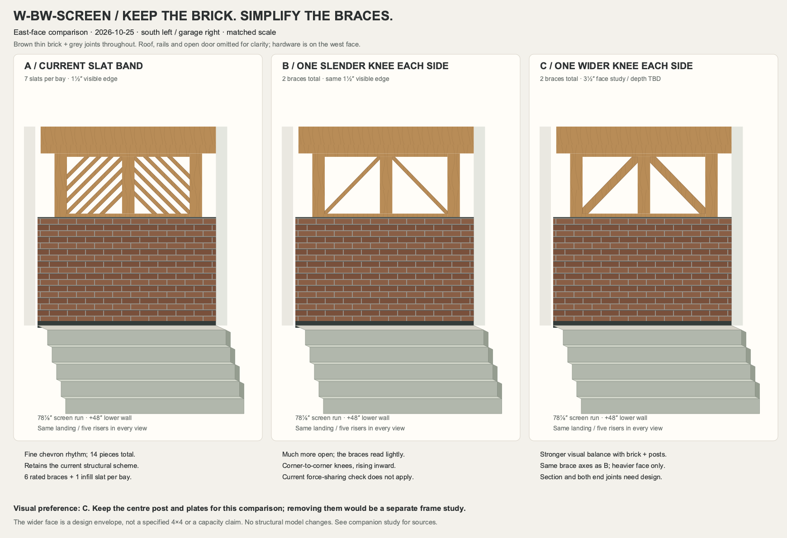

# W-BW-SCREEN — thin brick and single knee braces

Study: 2026-10-25. [Open the comparison sheet](assets/bw-screen-brace-comparison.svg).

The three matched east elevations retain the current brown thin brick with grey joints,
including its +2″ to +47½″ finish field. Brick modules follow the current finish spec:
7⅝″ × 2¼″ faces with ⅜″ joints. Colors are illustrative. The lower wall, posts,
symmetric west header tails, centre post and band plates are identical in all views.
The screen is in true elevation; the landing and five risers project obliquely.
Roof, rails, door and west-face connector details are omitted for clarity.

| Option | Visible arrangement | Assessment |
|---|---|---|
| A — current | Seven 1½″-edge slats per bay, fourteen total | Fine chevron texture; retains the modeled structural scheme |
| B — single slender | One 1½″-edge knee per bay, two total | Much more open; the diagonals look light against the brick |
| C — single wider | One 3½″-face knee per bay, two total; depth unspecified | Preferred visually: stronger balance with the brick and 5½″ posts |

B and C run truly corner to corner in each bay, mirrored so both knees rise inward
from the outer post/sill corner to the centre-post/top-plate corner. Their axes follow
the actual 24⅜″ × 25⅛″ bay, about 45.9° and 35″ corner to corner; both strip widths
are clipped to those boundaries. These are visual envelopes, not cutting templates.
The current KBS1Z connection cannot fit at these frame corners, so adopting this
arrangement requires a different end-connection detail.

The existing structural pass relies on multiple connected slats sharing force. Each
current bay has six connected braces and one screwed infill slat; four connected
slats per bay cross mid-band. Reducing this to one changes the force distribution
and the loads delivered into the posts and top plate. A thicker member alone does
not establish adequate end connections. In particular, the existing note already
rejects a simple 4×4/KBS1Z substitution because its required connection arrangement
does not match the recessed east face. C therefore specifies only its visible face,
not a 4×4 member or a connector schedule. Neither single-brace alternative has been
structurally checked; section, connections and complete frame load path need a
separate calculation before adopting either. The structural model is unchanged.

Source geometry and connection rationale:
[band parameters](../houses/catlin/params/entry_band_brace.py),
[structural basis §3](../houses/catlin/notes/canopy_west_band.md),
[current finish specification](../houses/catlin/plan/entry_screen_finish_spec.py),
and [earlier finish comparison](bw-screen-finish-comparison.md).
The current pattern uses the engine's clipped-slat profile routine and the documented
2¼″ clear gap, rather than the earlier finish sheet's schematic slat spacing.

Regenerate the SVG with `.venv/bin/python scripts/review-bw-screen-braces.py`.
