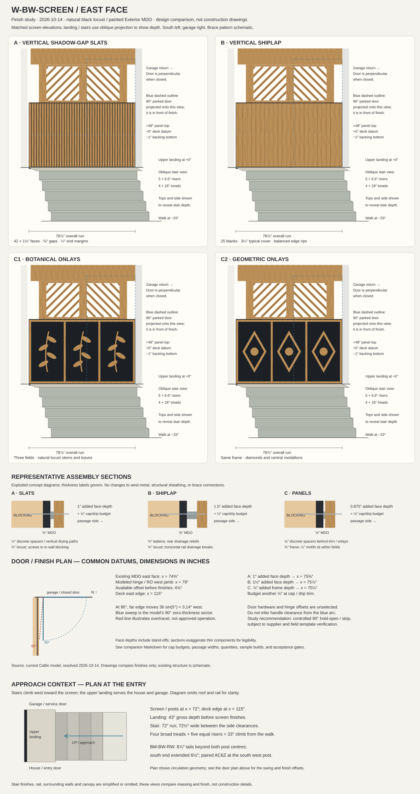

# W-BW-SCREEN — east-face finish comparison

**Study date:** 2026-10-14. **Status:** design comparison; no house-model changes and no construction fastening schedule.

**Recommendation:** develop **A, natural black locust vertical slats over matte black MDO**, first. It adds a fine vertical rhythm below the much heavier diagonal brace band, uses narrow clear stock well, and makes individual pieces replaceable. Keep **C, ornamental panels**, as the stronger alternative if the sample feels too repetitive. Shiplap ranks third: it loses the black shadow contrast, consumes wider stock, and needs the deepest support assembly in this study.

Owner priorities: appearance and craftsmanship; own/local locust and own milling; visible stainless screws; natural wood over black; include ornamental onlays rather than limiting panels to plain rectangles.

## 1. Matched elevations and common boundaries

[Open the elevation, section, and door-plan sheet](assets/bw-screen-finish-comparison.svg).

The sheet shows three alternatives, with botanical and geometric versions of C. Existing brace members are schematic, not a fabrication drawing. The blue dashed door rectangle is a projection of the **90° open leaf in front of the screen**; the closed garage door lies on a perpendicular return and cannot be shown face-on in this elevation.

Source geometry was checked by loading and resolving the current Catlin plan without modifying it; resolve returned zero error findings. Model datums, in inches:

| Datum | Value / consequence |
|---|---|
| Screen run, south to north | y = 439.750 to 518.625; **78⅞″** long |
| Lower wall | z = −1″ to +48″; **49″ backing height**, 48″ above deck |
| Study finish field | z = +½″ to +47½″; **47″ pieces**, leaving drying/termination gaps |
| Stud centreline | x = 72″; stud east face x = 73¾″ |
| Existing MDO east face | x = **74⅜″**, with ⅝″ backing |
| Two west post centres | y = 450″ and 509¾″; 5½″ square, east face x = 74¾″ |
| Brace / header | Brace band starts at +48″; header soffit +76⅛″, top +88″ |
| Garage service door | 36″ × 80″ nominal; west RO/idealized hinge x = **79″** |
| East deck edge | x = **115″**; an edge datum, not a second wall |

Source of truth: [screen assembly](../houses/catlin/plan/assemblies/site_hardscape.py), [screen placement](../houses/catlin/params/breezeway.py), [entry datums](../houses/catlin/params/north_entry_frame.py), [brace band](../houses/catlin/params/entry_band_brace.py), and [service door](../houses/catlin/plan/storeys/garage.py). The [door note](../houses/catlin/notes/garage_service_door_outswing.md) requires an exterior hold-open closer but does not select its product or opening angle.

All alternatives retain the west CDX and corrugated plane, structural connections, guard geometry, skirt drainage and access below the east face. Do not carry decorative work into the open band under the deck or attach it to the diagonal braces. Low-level decorative panels cover the lower post positions; the posts remain exposed above them, as in the drawing.

## 2. The three finishes

### A — vertical slats, preferred

- **42 slats**, actual ¾″ thick × 1½″ wide × 47″ long; 41 gaps at ⅜″; ¼″ margin at each end. Check: `42 × 1.5 + 41 × 0.375 + 2 × 0.25 = 78.875″`.
- Paint the Exterior MDO matte near-black, using the project's existing dark tone `#1c1f24` as the visual starting point. Prime and finish faces, edges and cutouts before installation; treat the paint system as a finish, not a substitute for drainage.
- Use **¼″ discrete nonabsorptive spacers** at screw points, maintaining downward drying paths between spacers. Added face depth: **1″**, or **1⅛″** including the study's maximum cap/drip projection.
- Concealed horizontal blocking within the existing stud depth provides wood at the screw rows. Allow three study rows near z = 3″, 24″ and 45″; verify their relationship to plates and hardware before detailing. These are layout rows, not a fastening capacity claim.
- Predrill locust and seat visible stainless heads flush without crushing the face. Use screws compatible with treated backing. The sample must determine pilot preparation, head appearance and practical edge distances; the final screw diameter, length and spacing remain for construction detailing.
- Ease touch edges consistently and lightly; avoid deep profiles that make narrow strips look rounded. Do not fill the black gaps with caulk or glue the strips to the panel.

The 1″ added face sits ⅝″ proud of the posts' east faces. Terminate with a deliberate black reveal rather than trying to make the lower trim flush with those posts.

### B — vertical shiplap

- Use **25 blanks**, actual ¾″ × 3½″ × 47″. Study a ¼″ lateral lap with a small visible reveal; typical cover is 3¼″. Machine complementary half-thickness laps with movement clearance, rather than fitting both shoulders tightly.
- Before edge trimming, 25 boards cover `25 × 3.5 − 24 × 0.25 = 81.5″`. Remove 1 9/16″ from each outside edge, leaving two 1 15/16″ edge boards and 23 full blanks to cover 78⅜″ between the ¼″ end margins.
- Visible screws go through full-thickness board material into horizontal battens backed at framing/blocking. Do not fasten through adjacent overlapping boards together and restrain their movement.
- Allow **¾″ horizontal battens + ¾″ locust = 1½″** added depth; budget **1⅝″** with cap/drip. Provide rear vertical drainage reliefs in the battens; this relief is within their ¾″ depth. Confirm its effectiveness with the sample. A separate additional spacer layer would increase the clearance budget.
- Retain and protect the MDO behind it. This is a decorative outdoor screen, not an insulated wall, and these concepts do not establish a new building-envelope control layer.

It gives a broad, quiet wood field, but the narrow edge rips and repeated seams should be judged at full size. Do not substitute interior tongue-and-groove assumptions for exterior movement and drying details.

### C — painted fields with ornamental locust frames and onlays

- Use the existing smooth MDO as the painted field; **no extra face sheet by default**. A separate overlay is useful only if the actual panel surface needs repair or removable decorative cassettes are later desired.
- Frame a 78⅜″ × 47″ composition with ¾″ × 1½″ locust: two continuous rails and four stiles between them. Three clear fields are **24⅛″ wide × 44″ high**.
- **C1, botanical:** one upward branch per field with broad leaves. Cut stems and leaves as grain-conscious pieces, avoiding slender cross-grain necks. The sheet shows composition, not cutting templates.
- **C2, geometric:** a diamond and central medallion in each field. It relates to the diagonal braces but risks making their geometry feel repetitive. Use separate sloping pieces rather than a fragile cross-grain outline cut from one board.
- Use ½″ onlays within the fields and ⅛″ discrete stand-offs behind trim and motifs. **Do not stack the motifs over the frame:** maximum added frame depth is **⅞″**, or **1″** with cap/drip. Keep screws visible, deliberately placed, and accessible.
- Bevel upward-facing edges; avoid cups, deep recesses and horizontal shelves. A durable wood species does not protect painted plywood trapped behind wet trim.

Optional ¼″ Exterior-rated face overlay adds ¼″ everywhere, including at the door. It is not included in the baseline quantity or clearance tables. Do not use interior MDF, interior plywood or absorbent composition onlays outdoors.

## 3. Backing, head, edges and bottom

**Keep ⅝″ Exterior-rated MDO as the comparison baseline.** Ordinary “CDX” commonly denotes Exposure 1 rather than Exterior, and simply increasing its thickness does not address long-term exposure or paint appearance. APA distinguishes these exposure ratings and recommends MDO for a smooth exterior painted appearance. Specify a paint-grade product and verify its actual stamp and finishing instructions; do not assume every overlay product has the intended exposure rating. [APA plywood classification](https://www.apawood.org/engineered-wood-products/plywood-osb/plywood/), [APA soffit finish guidance](https://www.apawood.org/buildertips/pdfs/N330.pdf).

| Backing | Design implication | Recommendation |
|---|---|---|
| ⅝″ Exterior MDO | Current thickness; visible smooth black field; screw rows supported by solid backing | Preferred baseline |
| ¾″ Exterior MDO | Adds ⅛″ toward passage; changes panel stiffness but does not establish screw withdrawal capacity | Use only if stock availability or documented panel/attachment requirements justify it |
| ¾″ ordinary CDX | Adds depth while introducing a rougher visible field and potentially unsuitable exposure classification | Do not choose merely to obtain extra screw holding |

**Head section:** retain the structural sill under the brace. Study a dark, sloped local head trim beneath it that sheds outward over the decorative faces, with an open drying path behind. Budget a maximum ⅛″ projection beyond the wood face. Establish the actual flashing overlap and attachment around the existing sill and connectors before construction; do not notch the sill or obstruct brace hardware to accommodate trim.

**Bottom section:** finish pieces stop ½″ above the deck; the backing remains at its modeled −1″ bottom. Seal and coat panel edges and expose the bottom of the spacer/batten drainage paths. No continuous bottom sealant bead, enclosed trough, or horizontal trim sitting on the deck. Bevel finish end grain to shed water and coat it with the selected compatible end treatment. A water test must check whether the proposed ½″ gap is sufficient in the actual deck detail.

**End section:** preserve ¼″ study margins to the run's ends. Use painted returns/reveals; keep trim clear of the garage cladding termination and the house-side drainage separation. Confirm these margins against finished wall returns before cutting the full run. Slats may conceal a backing joint but must not bridge a movement joint between structures.

**49″ backing height:** a single standard 48″ × 96″ sheet cannot cover the entire modeled 49″ × 78⅞″ rectangle. The existing model is not a sheet-cut plan. If buying backing, develop an oversized-sheet or supported multi-piece layout that protects the below-deck edge; do not hide an unsupported 1″ strip behind finish. The quantities below state net area rather than promising a one-sheet purchase.

## 4. Door and passage clearance

The model's resolved door sweep runs from hinge `(79, 518.625)` to parked tip `(79, 482.625)` at 90°. It is a **zero-thickness, hardware-free sector**, not a selected door assembly. The generic rendered leaf and lever do not establish the actual hinge, handle or closer clearances.

`79 − 74.375 = 4.625″` is the available datum offset before adding finish. The following table includes support depth and a **⅛″ cap/drip budget**. Widths are geometric distance to the east deck edge with the door absent, not certified egress or landing widths.

| Assembly | Added wood face / maximum trim depth | Maximum east face x | Offset to idealized hinge | Finish-to-deck-edge width |
|---|---:|---:|---:|---:|
| Existing ⅝″ MDO only | 0″ / 0″ | 74⅜″ | 4⅝″ | 40⅝″ |
| A — slats | 1″ / 1⅛″ | 75½″ | **3½″** | **39½″** |
| B — shiplap | 1½″ / 1⅝″ | 76″ | **3″** | **39″** |
| C — ornamental panels | ⅞″ / 1″ | 75⅜″ | **3⅝″** | **39⅝″** |

A ¾″ replacement backing reduces every remaining dimension by another ⅛″; an optional ¼″ panel overlay reduces it by ¼″. Any trim or screw head projecting beyond these envelopes must be added separately.

For a preliminary 90° hardware check, if the real hinge were on the model datum and centered on the slab thickness:

`remaining gap = hinge offset − leaf thickness / 2 − westward hardware projection`.

An **illustrative**, unselected 1¾″ slab with hardware projecting 2½″ west of its face leaves only **⅛″ for A**, **−⅜″ for B**, and **¼″ for C** at the maximum trim envelope. Set **¼″ residual clearance** as a study target, not a code requirement; A would need a smaller hardware projection, a changed hinge offset, or a slimmer local detail to reach it in this example. Check the maximum trim only where it overlaps the hardware vertically; handles are low, while closer bodies/arms may overlap the brace and header instead.

**Overtravel matters:** at 95°, the far edge moves `36 × sin(5°) = 3.138″` west of the hinge datum. Even before hardware, the illustrative half-slab allowance uses up A's remaining space. Do not assume a closer's “hold-open” feature limits opening travel. Require a compatible opening stop/limiter and approved hold-open setting if the selected design relies on 90° operation; verify its effect on access and door operation.

**Finding:** the proposed finish faces lie outside the model's 0–90° zero-thickness sweep, but **full door/hardware clearance is not confirmed**. No selected hinge offsets, handle or closer submittal exists in the inspected source. Before release:

1. Obtain the actual frame, hinge axis, leaf thickness, both lever projections, closer body/arm envelope, and permitted hold-open/maximum opening angles.
2. Template the complete assembly at the doorway, including the final cap, stand-offs and any overlay. Check closed-to-maximum travel, not only the parked position.
3. Check the lower finish against the leaf/handle and the upper brace/header against the closer. Provide an independent compatible stop where required by the hardware design.
4. Measure the usable route with the door both closed and parked. The parked leaf at x≈79″ leaves only **36″ nominal** to x=115″ before its thickness and hardware; the finish-to-edge table does not represent this condition.

## 5. Quantities, yield and owner effort

These are study quantities for the nominal run, **not engine takeoff output**. They exclude final screw capacity sizing, stock defects, samples and finish dry time.

| Item | A — slats | B — shiplap | C — either ornamental composition |
|---|---:|---:|---:|
| Retained backing | 26.84 ft² net, 49″ × 78⅞″ | Same | Same |
| Main locust pieces | 42 × 47″, 1½″ wide | 25 × 47″, 3½″ blanks; two edge rips | 2 rails × 78⅜″; 4 stiles × 44″, all 1½″ wide |
| Main stock length | **164.50 lf** | **97.92 lf** before edge rips | **27.73 lf** of frame |
| Finished rectangular blank volume | **15.42 board feet** | **21.42 board feet** before laps/edge rips | **2.60 bf frame + 1.50 bf motif blanks = 4.10 bf** |
| Motif allowance | — | — | Six ½″ × 6″ × 12″ blanks; composition/yield allowance, not a cut list |
| Rough-stock allowance at 50–70% volume recovery | **22.0–30.8 bf** | **30.6–42.8 bf** | **5.9–8.2 bf** |
| Support allowance | 3 in-wall rows, about 19.72 lf gross before studs | Same backing plus about 19.59 lf of face battens | Support at frame/onlay screws; allow same 3 backing rows for comparison |
| Visible screw allowance | 126 at three study rows | 75 at three study rows | 60 provisional, dependent on motif segmentation |
| Purchase allowance including screw spares | 150 screws | 90 screws plus batten fixings | 75 screws |
| Head trim | About 7 lf | About 7 lf | About 7 lf |
| Owner fabrication + dry fit | **8–14 hours** | **10–18 hours** | **18–36 hours** |
| Owner preparation, finish application + installation | **8–14 hours** | **8–14 hours** | **10–18 hours** |

Board feet here use actual blank dimensions, `thickness × width × length / 144`. Rough-stock ranges divide finished blank volume by 0.70 and 0.50; they are sensitivity estimates, not measured recovery from your wood. They include assumed thickness/kerf/defect loss; do not add a second generic waste factor on top. For C, carving/cutout waste is already inside the motif blank allowance. Labor ranges are planning judgments for a small one-off shop project, not quoted rates or measured times.

**Inventory before milling:** record species/heartwood content, usable lengths ≥47″ plus trimming allowance, thickness after flattening, moisture condition, defects and clear rip widths. Keep a cut map. A can use narrower pieces than B, but ripping narrow strips also increases kerf loss. C uses short/offcut stock well, provided grain direction suits the ornament. Use a small milling trial to replace the assumed recovery with actual yield; wet or unstable stock adds drying work outside these hour estimates.

**Purchased materials, separate from owner labor:** Exterior MDO only if the specified backing is not already supplied; primer and exterior paint; compatible locust finish/end treatment; stainless screws and spare bits; nonabsorptive spacers; treated blocking/batten stock as needed; head trim; abrasives and cutting-tool wear. C's optional overlay is an additional purchase. Use current supplier quotes after selecting the sample—no unsupported dollar total is implied here.

**Finish area for budgeting:** A has about **62.3 ft² of slat surface** across faces, sides and ends; B's rectangular blanks have about **70.3 ft²** before profiling. Add the backing (26.84 ft² per face, plus edges) and support/trim surfaces; C needs a cut-list-based finish calculation after its motifs are chosen. Apply the selected products' published coverage and coat counts. The black area left visible between A's strips is only about 5.73 ft²; coating only that area would leave unprotected material behind the slats.

## 6. Finish, maintenance and repair comparison

| Criterion | A — slats | B — shiplap | C — ornamental panels |
|---|---|---|---|
| Visual character | Fine, deep, warm/black contrast; strongest match to original idea | Broad wood plane; least black visible | Most expressive; composition competes with brace band unless restrained |
| Cleaning / drying | Open vertical gaps, but narrow spaces collect dirt | Broad faces easiest to wipe; concealed batten drainage needs care | Broad painted fields accessible; extra edges and motifs require attention |
| Backing repaint | Remove strips as needed; many screws | Remove boards in sequence around laps | Remove motifs/frame parts; large fields remain accessible |
| Local repair | One slat at a time | Lap sequence can require adjacent-board removal | Individually screwed parts; retain motif templates |
| Maintained warm finish | Many edges and sides to recoat | Fewer visible edges; broad finish area | Detailed handwork, especially around ornament |
| Natural weathering | Likely uneven at tops, bottoms, gaps and door-shaded areas | Broad differences by exposure and lap | Frame/onlay shadows may leave outlines on the field |

For the preferred warm appearance, sample a penetrating exterior finish explicitly suitable for dense locust; coat all sides before assembly and treat fresh cuts with a compatible product. Do not promise a recoat interval before observing the actual exposure. A clear appearance does not guarantee permanent honey color. An unfinished sample should remain alongside the finished one: sheltered east-facing locust can change slowly and unevenly rather than becoming a uniform silver panel.

Robi's supplier guidance supports stainless fasteners, compatible all-side finishing and drainage behind siding; it also describes predrilled face screws. Its proprietary profiles and product moisture assumptions do **not** establish movement allowances or screw capacity for owner-milled strips. [Supplier installation guidance](https://robidecking.com/resources/installation/).

## 7. Three approximately 24″ square physical samples

These are instructions for owner/shop work; **no physical samples or physical performance tests have been completed by this study**. Use actual intended stock, backing, spacer materials, paint, finish and visible screw heads. Label stock moisture, milling date, finish and screw preparation on the rear. Compare all three vertically in the entry's actual light before committing the full run.

1. **A — 24″ × 24″:** ⅝″ Exterior MDO, black-painted before assembly. Fit twelve 1½″ × 23″ slats at ⅜″ gaps, centered with 15/16″ side margins and ½″ top/bottom margins. Provide rear blocking at three screw rows and ¼″ discrete face spacers. Use 36 study screws. Finish six slats with the candidate warm finish; leave six unfinished for comparison. Sample margins differ from the full elevation so the standard slat module fits the sample.
2. **B — 24″ × 24″:** same backing, ¾″ rear-relieved horizontal battens at three rows and seven 23″ shiplap blanks. Seven 3½″ blanks with six ¼″ laps cover exactly 23″, leaving ½″ side margins. Use 21 study screws through full-thickness material. Compare finished and unfinished boards. Include one accessible lap for inspecting movement and trapped water.
3. **C — 24″ × 24″:** use the MDO as the painted field. Build a 23″ square frame, 1½″ wide × ¾″ thick, on ⅛″ discrete spacers, centered with ½″ margins. Fit removable ½″ botanical motifs on one side of the field and a geometric motif on the other, both within the frame depth. Use grain-safe segmented pieces and visible screws. Split finish treatments between removable components rather than trying to predict which motif will weather better from a short trial.

Provide extra offcuts for pilot-hole and head-seating trials rather than experimenting on the finished sample faces. Physical samples consume additional stock and fasteners beyond the full-run table; three 24″ square backing pieces total 12 ft² net and can come from one standard sheet with offcuts.

**Record against each sample:**

- Appearance from roughly 3′ and 10′ in daylight and entry lighting, including a card/photo of the existing brace above it. Record whether the black field feels too dominant or the ornament too busy.
- Touch edges without splinters, snagging or sharp screw heads; consistent eased edges and even reveal widths.
- Screw seating without splits or crushed faces, followed by removal/reinstallation to assess repair access. A shop trial is workmanship evidence, not a rated fastening test.
- Gentle wetting of the vertical face, with drainage exiting beneath the finish and no persistent water trapped behind spacers, laps, horizontal battens or onlays. Open the sample afterward to inspect concealed surfaces; record observations immediately and after drying.
- After exposure, look for cupping, checking, joint closing and finish discoloration. A short trial cannot certify seasonal movement or years of coating life.
- Try cleaning and touching up a black gap, removing one wood piece, and reaching the painted backing. Record time and damage.
- Use a full-thickness strip/template at the **actual doorway** for each assembly and the actual hardware. A freestanding 24″ sample cannot confirm door clearance.

## 8. Selection and release gates

**Ranking for the stated priorities:** A first; C second (botanical preferred for contrast with the diagonal braces, geometric retained for comparison); B third. Retain ⅝″ MDO unless a specific procurement or attachment requirement changes the decision.

Proceed toward A if the sample confirms its proportions, warm finish, screw appearance and acceptable repaint access **and** the door/hardware template meets the chosen clearance target throughout travel. Favor C if a broader black field with custom ornament looks better in the actual entry. Do not resolve a door collision by quietly assuming thinner hardware, omitting a spacer, or allowing uncontrolled overtravel.

Before a later construction/model implementation, record the selected finish, actual dry stock dimensions, backing product/cut layout, support and drainage details, rated fastener selection, hardware/stop clearance and added finish weight. Added weight must enter the existing wall/guard/support accounting at that stage; this study neither assigns it structural credit nor verifies the support system for an added load. Preserve wall identity, structure, west plane and open skirt drainage.

**Checks completed for this document:** read-only model resolution and datum extraction; arithmetic for profiles, quantities and nominal clearance; SVG parsing/render inspection; local-link checks. **Not completed:** stock inventory, supplier hardware templates, physical sample tests or final construction engineering.
